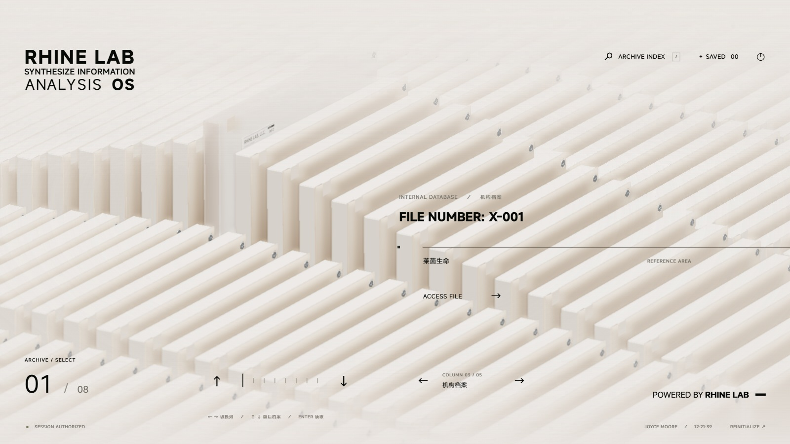

# RhineLab Music — 萊茵生命 3D 互動桌面音樂終端

**把萊茵生命的終端，做成可實際操作的 Windows 64 位元三維桌面音樂播放器。**

[](https://github.com/ychengyu/RhineLab-Music/releases/download/v1.0.0/RhineLab-Music-Setup-v1.0.0.exe)
[](https://github.com/ychengyu/RhineLab-Music/releases/download/v1.0.0/RhineLab-Music-Portable-v1.0.0-Win64.zip)
[](https://github.com/ychengyu/RhineLab-Music/releases/tag/v1.0.0)



RhineLab Music 改造自 [LBEILC/RhineLabUI](https://github.com/LBEILC/RhineLabUI)，沿用原始 **TypeScript + Three.js + Vite** 即時三維渲染架構、GLB 卡盒模型與玻璃光學材質，並專為 **Windows 電腦桌面端** 打造無邊框 WebView2 原生宿主、本機與跨平臺串流音訊代理、高解析度超採樣渲染與多種抗鋸齒管線。

---

## 直接下載安裝（Windows 10 / 11 64 位元）

前往 **[GitHub Releases (v1.0.0)](https://github.com/ychengyu/RhineLab-Music/releases/tag/v1.0.0)** 下載：

| 版本 | 檔案 | 說明 |
| --- | --- | --- |
| **一鍵安裝精靈（推薦）** | [`RhineLab-Music-Setup-v1.0.0.exe`](https://github.com/ychengyu/RhineLab-Music/releases/download/v1.0.0/RhineLab-Music-Setup-v1.0.0.exe) | 免系統管理員權限安裝（預設 `%LOCALAPPDATA%\Programs\RhineLab Music`，可自訂資料夾），自動建立桌面與開始功能表捷徑、偵測 WebView2 Runtime 並登錄 Windows 解除安裝程式 |
| **免安裝攜帶版 ZIP** | [`RhineLab-Music-Portable-v1.0.0-Win64.zip`](https://github.com/ychengyu/RhineLab-Music/releases/download/v1.0.0/RhineLab-Music-Portable-v1.0.0-Win64.zip) | 解壓縮至任意資料夾後，直接雙擊執行 `RhineLab-Music.exe` 即可使用 |
| **SHA-256 校驗清單** | [`SHA256SUMS.txt`](https://github.com/ychengyu/RhineLab-Music/releases/download/v1.0.0/SHA256SUMS.txt) | 安裝檔與攜帶版壓縮包之 SHA-256 雜湊校驗碼 |

---

## 核心功能

### 1. 本機無損與跨平臺音樂播放
- **本機音訊匯入**：支援 MP3、WAV、FLAC、ALAC、OGG、AAC、M4A、AIFF、DSF 等格式，支援檔案選取與拖曳匯入、自動解析 ID3 / Vorbis / MP4 標籤與內嵌封面，亦可隨時上傳自訂曲目封面。
- **跨平臺連結與歌單匯入**：支援匯入 YouTube（含單曲、公開播放清單、`music.youtube.com`）、Bilibili、Spotify 與直接音訊串流連結。詳見 [平臺設定、權限與限制](docs/MUSIC-PLATFORMS.md)。
- **1 MB 首段記憶體預熱與串流代理**：桌面版內建本機背景串流代理與 LRU 1 MB 首段 RAM 快取（`headCache`），播放中自動預熱下一首曲目並在首次播放時同步擷取首段快取，切歌、上一首與從頭重播（`↻`）皆可瞬間響應。
- **共用單例 `AudioContext` 與高 DPI 即時頻譜**：曲目切換時零重建音訊上下文，於「01 曲目簡介」分頁提供高 DPI 漸層即時頻譜與峰值保持（Peak-Hold）動態波形。

### 2. 三維玻璃唱片匣與音樂律動
- **3D 唱片檢視與陣列切換**：主畫面可左右旋轉檢視透明玻璃唱片匣與雙環內構，亦可一鍵切換回五列循環 3D 唱片陣列或收藏清單範圍。
- **音樂律動與燈效模式**：唱片模型與邊框燈環會隨音樂低／中／高頻能量與節拍即時律動，支援「音訊律動（Reactive）」、「RGB 流光」、「呼吸燈」、「自訂顏色」與關閉。
- **介面操作音效**：內建清脆玻璃互動音與終端電子回饋音效，可在設定中獨立開關並即時預覽調整音量。

### 3. 畫質設定、1080p / 2K / 4K 解析度與 FXAA / SMAA / TAA 抗鋸齒
- **目標渲染解析度**：支援 **自動原生（Native）**、**1080p（FHD）**、**2K（1440p QHD）**、**4K（2160p UHD）** 超採樣渲染，設定頁即時顯示當前實際像素尺寸、倍率與抗鋸齒狀態。
- **完整抗鋸齒模式**：內建 **關閉（Off）**、**FXAA（快速邊緣抗鋸齒）**、**SMAA（次像素形態學抗鋸齒）**、**TAA（時間採樣抗鋸齒）** 四種模式，並採用 `1024 × 1024` 6px 柔邊 Mipmap + 各向異性過濾封面貼圖以消除斜邊鋸齒。
- **多檔畫質與桌面圖形後端**：提供效能、平衡、原始、高畫質、極致畫質與自訂參數（解析度倍率、螢幕像素比、景深強度），桌面版亦可於設定中切換 GPU 偏好與渲染後端（D3D11 / D3D12 / OpenGL / Vulkan）。

---

## 從原始碼啟動與打包

需要 **Node.js 22.16 以上**（支援 Node.js 24）與 npm。

### 1. 本地開發模式

```sh
npm ci
npm run dev
```

預設網址為 `http://127.0.0.1:5173`。Windows 使用者安裝 Node.js 後亦可直接雙擊 [`啟動終端.cmd`](啟動終端.cmd) 自動安裝依賴並開啟介面。

### 2. 型別檢查、測試與網頁建置

```sh
npm run typecheck
npm test
npm run check:content
npm run check:viewport
npm run build
npm run preview
```

### 3. 打包 Windows 64 位元獨立執行檔與安裝分享版

```sh
# 建置單檔無邊框桌面執行檔 (輸出至 release/desktop/RhineLab-Music.exe)
npm run build:exe

# 建置桌面執行檔 + 一鍵安裝精靈 + 免安裝攜帶版 ZIP (輸出至 release/share/)
npm run build:installer
```

> **打包前置元件**：執行 `build:exe` 或 `build:installer` 前，請將 WebView2 SDK 二進位檔（`Microsoft.Web.WebView2.Core.dll`、`Microsoft.Web.WebView2.WinForms.dll`、`WebView2Loader.dll`）放入 `vendor/webview2`（或設定環境變數 `WEBVIEW2_SDK_DIR`），並將 `yt-dlp.exe` 放入 `vendor/yt-dlp.exe`（或設定環境變數 `YTDLP_PATH`）。

---

## 操作快捷鍵與控制說明

| 操作 | 效果 |
| --- | --- |
| 在 3D 唱片上左右拖曳 | 水平旋轉檢視透明唱片模型 |
| 滑鼠滾輪 | 縮放檢視距離 |
| 左下角 `[ ▤ ]` 或 `LIBRARY OVERVIEW` | 切換「唱片特寫檢視」與「3D 陣列總覽 / 音樂庫」 |
| 左下角 `[ ↻ ]` | 視角歸位並從 `0:00` 重新播放當前曲目 |
| `收藏清單` / `全部歌曲` | 切換 3D 陣列牆顯示範圍 |
| `/` 或右上角 `MUSIC INDEX` | 開啟曲目索引與跨來源搜尋 |
| `＋ SAVED` / `＋ SAVE TRACK 收藏曲目` | 查看收藏清單 / 收藏或取消收藏目前曲目 |
| 右上角 `設定` | 切換亮／暗色主題、目標解析度（1080p/2K/4K）、抗鋸齒（FXAA/SMAA/TAA）、音質、燈效與音效音量 |
| `Esc` | 關閉目前彈窗，或返回上一層檢視 |

---

## 專案目錄結構

| 目錄或檔案 | 說明 |
| --- | --- |
| [`src/music/app.ts`](src/music/app.ts) | 音樂終端主控制器、設定面板、高 DPI 即時頻譜、音效回饋與桌面視窗整合 |
| [`src/music/interface.ts`](src/music/interface.ts)、[`src/music/music.css`](src/music/music.css) | 無邊框桌面版介面結構與樣式表 |
| [`src/music/player.ts`](src/music/player.ts)、[`src/music/adapters.ts`](src/music/adapters.ts) | 播放佇列狀態機、共用單例 `AudioContext` 與本機／YouTube／Bilibili／Spotify／串流代理播放介面卡 |
| [`src/music/library.ts`](src/music/library.ts) | IndexedDB 音樂庫、收藏清單、播放清單、LRC 歌詞與偏好設定儲存 |
| [`src/music/wall.ts`](src/music/wall.ts) | 3D 唱片牆控制器、曲目封面非同步載入、畫質／解析度／抗鋸齒與音樂律動同步 |
| [`src/scene.ts`](src/scene.ts) | Three.js 三維場景、透明玻璃材質、FXAA / SMAA / TAA 後製管線與零分配動態追蹤 |
| [`src/render-quality.ts`](src/render-quality.ts)、[`src/quality-renderer.ts`](src/quality-renderer.ts) | 畫質預設、1080p / 2K / 4K 目標解析度計算與紋理過濾管線 |
| [`src/audio.ts`](src/audio.ts) | Web Audio 玻璃互動音效、終端電子回饋音效與原創三軌背景配樂合成 |
| [`scripts/launcher.cs`](scripts/launcher.cs) | Windows 64 位元無邊框 WebView2 原生宿主、本機 HTTP 伺服器與 1 MB 記憶體預熱串流代理 |
| [`scripts/installer.cs`](scripts/installer.cs)、[`scripts/build-installer.mjs`](scripts/build-installer.mjs) | Windows 64 位元安裝精靈（含捷徑建立、WebView2 檢查與解除安裝器）及分享包建置腳本 |
| [`scripts/build-exe.mjs`](scripts/build-exe.mjs) | 單檔獨立桌面執行檔與多尺寸 32 位元 BGRA DIB `.ico` 圖示打包腳本 |
| [`docs/`](docs/) | [改造紀錄](docs/MUSIC-CHANGES.md)、[平臺設定說明](docs/MUSIC-PLATFORMS.md)、[驗收報告](docs/MUSIC-VERIFICATION.md) |

---

## 授權與上游來源說明

本專案程式碼、建模腳本、技術文件、Blender 源工程、GLB 模型與原創配樂／音效採用 **[MIT License](LICENSE)** 開源授權，上游基底與三維視覺資產來自 **[LBEILC / RhineLabUI](https://github.com/LBEILC/RhineLabUI)**（Copyright (c) 2026 LBEILC）。

以下第三方內容與權利不在 MIT 授權範圍內：
- **《明日方舟》相關設定與視覺元素**：包含《明日方舟》及萊茵生命相關名稱、標誌與設定，相關權利歸各自權利人所有，本專案為非官方技術展示與播放器改造，與官方無隸屬關係。
- **第三方字體與開源元件**：
  - **MiSans**：使用小米官方字體檔案，保留 [字體授權說明](public/fonts/MiSans-license.pdf) 與 [`public/fonts/NOTICE.txt`](public/fonts/NOTICE.txt)。
  - **Rolling Number**：用於編號與標題文字滾動動畫，授權見 [`public/licenses/rolling-number.txt`](public/licenses/rolling-number.txt)。
  - 其他第三方套件與二進位工具（Three.js、`music-metadata`、WebView2 SDK、`yt-dlp`）各自遵循其原始開源或官方散布條款。
放