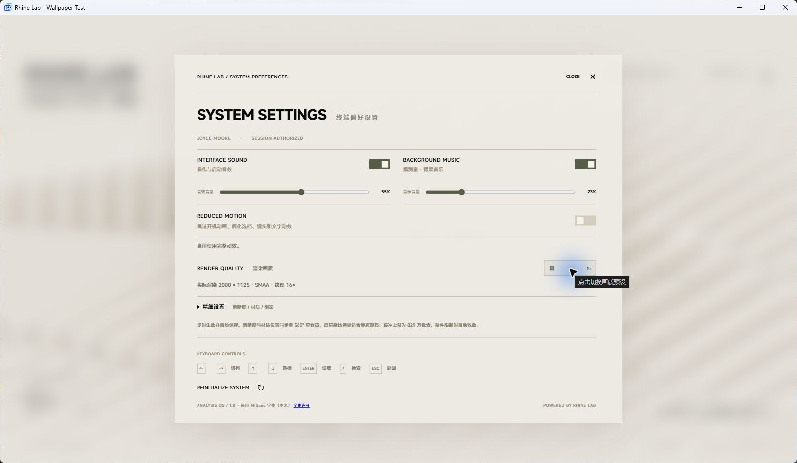

# Wallpaper Engine 本地實驗

分支：`codex/wallpaper-engine`。2026-09-10 已在本機 Wallpaper Engine 的獨立窗口中運行，尚未發布創意工坊、尚未應用到桌面，不合并主分支。

## 本機入口

Wallpaper Engine 本地庫名稱：**Rhine Lab · 萊茵生命檔案終端（本地測試）**。

安裝目錄：`D:\Game\Steam\steamapps\common\wallpaper_engine\projects\myprojects\rhine-lab-local`。

當前預覽窗口：**Rhine Lab - Wallpaper Test**。重新打開獨立預覽：

```powershell
& 'D:\Game\Steam\steamapps\common\wallpaper_engine\wallpaper64.exe' -control openWallpaper -file 'D:\Game\Steam\steamapps\common\wallpaper_engine\projects\myprojects\rhine-lab-local\project.json' -playInWindow 'Rhine Lab - Wallpaper Test' -width 1600 -height 900
```

項目目錄中的 `project.json` 帶有本地標題、預覽圖片和可調屬性。只有構建產物目錄應導入編輯器，不能導入整個源碼倉庫。重新發布未來已有的工坊項目時，應保留該項目的工坊 ID 與元數據。

## 構建與行為

```sh
npm run build:wallpaper
node scripts/check-wallpaper.mjs
```

構建輸出 `release/wallpaper`，約 34.1 MiB，823 個文件，包括完整字體分包、模型、音頻、檔案 TXT 和許可。字體和模型均本地讀取，無需開發服務器或在線站點。源碼、Blender 工程、參考視頻、診斷服務不進入壁紙包。

- Vite 的 `wallpaper` 模式使用相對資源路徑，HTML 中提前注冊宿主回調，以免丟失模塊載入前的初始屬性。
- 自動啟動；宿主可以關閉開場，直接進入陣列。減少動態效果繼續遵循顯式設置。
- 聲音自動嘗試解鎖，等待最多 3 秒后繼續畫面；聲音未能解鎖時仍可通過后續點擊觸發。正常網頁的點擊啟動流程保留。
- 壁紙版關閉 PWA 初始化、安裝和更新界面。更新通過替換本地構建或未來的工坊更新完成。
- 宿主提供開場、音效、音樂、獨立音量、減少動態效果和四檔畫質。宿主只推送變化的屬性，頁面保留其余設置。
- 頁面設置也可使用；重載時宿主下發的值具有優先權，頁面內更改不會反向寫回 Wallpaper Engine 的屬性面板。
- 三維渲染跟隨宿主 FPS 上限（未收到時為 30），不會補渲染漏掉的幀。宿主暫停通知停止更新與音頻；開場恢復時扣除暫停時間。
- 壁紙版不提供瀏覽器全屏按鈕。畫質參數以點擊循環選項的按鈕呈現，保留原有參數值和高級設置。

## 本機驗證記錄

環境：Windows、本機 Wallpaper Engine 窗口顯示版本 2.8.36，獨立窗口 1600×900，真實 CEF / WebGL 渲染。管理界面另提示 2.8.42 已下載、待重啟，本次沒有執行更新。

已驗證：

- 自動開場、白底 Logo 與文字、中文字體、三維陣列本地加載。
- 鼠標點擊切檔（X-001 → X-006）、打開檔案、磨砂揭示和正文解密。
- 360° 模型本地加載、分層拆解與鼠標拖動旋轉。
- 初始宿主屬性 `boot=false` 直接進入陣列，`musicvolume=15` 在頁面顯示 15%。
- 運行中經官方 `applyProperties` 指令將音樂音量改為 23%，收到 `{musicvolume:{value:23}}` 回調，已打開的頁面控件同步至 23%。
- 畫質按鈕從“原始”切換為“高”，實際渲染從 1600×900 變為 2000×1125，并啟用 SMAA。
- 實際音頻狀態為 `running`，三條音樂軌道已載入并播放，錯誤字段為空。聲音主觀聽感仍由用戶試聽。
- 限幀、暫停恢復及部分屬性回調通過腳本驗證；新增回歸檢查確保壁紙不再生成原生 `<select>`。
- `npm run build:wallpaper` 與正常網頁 `npm run build` 均通過，網頁 PWA 構建成功。

運行數據有一次陣列采樣為 22 FPS（宿主上限 30），不能把上限寫成穩定實際幀率。本次未做長時間功耗測試、4K / 多屏壓力測試或真實桌面圖標遮擋下的完整輸入驗證。



### 本機 CEF 的下拉框崩潰

打開原設置頁會穩定出現 `STATUS_ILLEGAL_INSTRUCTION`。診斷確認頁面邏輯完成后、首次繪制前崩潰；最小彈窗和聲音控件正常，單獨畫質區域可復現，去掉其中 `<select>` 后正常。最終只在壁紙模式將畫質下拉框換為循環按鈕，恢復原背景模糊、焦點處理和原生音量滑塊后，全設置頁正常。

此記錄描述本機的復現與兼容處理，不斷言所有 CEF 版本都存在此問題。沒有修改 Wallpaper Engine 全局畫質、硬件加速或安全設置。

### 當前交付邊界

本地壁紙庫和獨立預覽可用；自動審批拒絕了替換主顯示器壁紙，需用戶明確批準后才應用到桌面。本次未上傳創意工坊。上傳前還應完成桌面輸入、長時間性能和發布素材的最終檢查。

## 官方接口參考

- [創建與導入網頁壁紙](https://docs.wallpaperengine.io/en/web/first/gettingstarted.html)
- [用戶屬性與暫停通知](https://docs.wallpaperengine.io/en/web/api/propertylistener.html)
- [FPS 限制](https://docs.wallpaperengine.io/en/web/performance/fps.html)
- [命令行預覽與屬性設置](https://help.wallpaperengine.io/en/functionality/cli.html)

## 桌面試用反饋與設置說明（2026-09-10）

用戶已自行應用到桌面。設置頂部明確說明：每次啟動讀取 Wallpaper Engine 屬性，頁面內修改只對當前運行生效；長期設置須在宿主屬性面板修改。畫質區不再提示自動保存。

用戶反饋桌面方向鍵與滾輪無效。代碼檢查確認兩類監聽仍保留，沒有壁紙模式禁用分支；尚未通過桌面事件跟蹤確認滾輪未傳入的具體原因。設置操作說明改為拖動陣列、點擊界面按鈕，并注明桌面可能無法傳入方向鍵和滾輪。Wallpaper Engine 開發者說明鍵盤輸入存在宿主限制：https://steamcommunity.com/app/431960/discussions/2/1644304412654510366/ 。

本次 `npm run build:wallpaper` 與 `node scripts/check-wallpaper.mjs` 通過。

## 工作臺首版

Wallpaper Engine 屬性新增顯示模式（桌面工作臺／檔案展示）、三條事項、重要日程名稱和本地目標日期、專注與休息分鐘數。頁面設置可臨時切換模式。空事項不會偽造數據。

工作臺左側始終顯示本機時間、日期、事項。右側五個功能入口與陣列五列聯動。事項點擊勾選或撤銷；按本地日期自動重置。完成狀態與計時存于獨立 rhine-workbench-v1 項，宿主屬性不覆蓋它們。內容改動清除對應舊完成狀態；存儲不可用顯示提示。該存儲不承諾跨設備、換目錄或卸載后保留。

專注與休息可開始、暫停、繼續、重置、切換。截止時間采用 Date.now()，壁紙暫停、遮擋或重載后校正，不補響后臺提醒，也不自動開始下一段。改變時長只影響下一次開始。媒體監聽在經典啟動腳本中提前注冊，支持標題、歌手、封面、狀態與可選進度；未啟用、無曲目或無進度均有空狀態。媒體來源取決于 Windows 媒體會話支持，模擬回調驗證不代表所有播放器實測成功。

驗證頁：reference/workbench-review.html（開發 wallpaper 模式），包含僅用于測試的宿主屬性與媒體回調。運行 node scripts/check-workbench.mjs 檢查日期邊界、暫停/重載計時和媒體切換殘留。當前仍為本地實驗，不合并正式網站。

2026-09-10 本次驗證：壁紙與普通網頁構建均通過；check-wallpaper 與 check-workbench 通過。在 Edge 實際頁面驗證設置切換、專注啟動、事項勾選后重載保留、模擬媒體標題與進度、有效目標日期和無效日期提示，并檢查桌面尺寸布局。媒體使用測試回調，未聲稱真實播放器聯動已驗證。本地安裝目錄已更新；本版尚待 Wallpaper Engine 桌面實際試聽與存儲復核。

2026-09-10 視覺修訂：按用戶要求撤回綠色主題，改用主頁現有顏色，取消信息面板底塊和導航色塊，復用豎線刻度與黑白按鈕狀態。壁紙構建通過，并在 Edge 實際運行頁面檢查布局；已更新本地壁紙包。

## 工作臺可配置顯示（2026-09-10）

純凈效果是工作臺的配置結果，不增加獨立模式。在 WE 中選擇“工作模式 → 桌面工作臺”，按需切換“工作臺：顯示…”七個開關。全部關閉時僅保留三維陣列；設置按鈕也可關閉，再從 WE 屬性恢復。開關在啟動時由宿主恢復，局部屬性更新不會重置其他選項。壁紙內沒有另一套臨時顯示開關。

工作臺顯示配置不影響檔案展示。隱藏專注內容不停止正在運行的計時，也不清除事項完成狀態。開場結束位置現在由下文的入場選項控制。

該階段壁紙構建、check-wallpaper、check-workbench 通過。Edge 實際頁面用宿主回調驗證全部隱藏、只留時鐘與外部恢復所有元素（包括設置入口），并檢查純凈陣列截圖。

## 音樂律動、波紋接力與入場（2026-09-10）

WE 屬性使用六個原生可折疊 group：入場與畫面、工作臺界面顯示、事項與日程、聲音、音樂律動、波紋接力。工作模式始終在最上方。工作臺分組僅在工作臺模式顯示；關閉聲音、律動或游戲入口后隱藏對應音量、強度或節奏參數，保留已有值。使用本機 WE UI 實現中確認的 group 和 condition 字段，不偽造多層導航。

“入場時展示檔案詳情”提供隨工作模式、展示詳情、跳過詳情三個選擇。默認工作臺在原片約 30.90 秒（內部時間 25.90）結束，陣列已進入并出現選擇波浪，尚未進入完整抽取和特寫；檔案展示默認保留完整開場。工作臺內容以 460ms 淡入和 9px 上移錯峰顯示。減少動態效果時直接顯示。帶 time 參數的逐幀對照仍保留完整原時間軸。

音樂律動只作用于工作臺陣列；低、中、高頻分別驅動寬波、小波與稀疏輕抬，保留原材質。默認開啟、強度 100%，可設 0–200%。宿主沒有信號或停止回調后緩慢回落。選中高度可設保持原樣、僅音樂律動時歸齊（默認）、始終歸齊；歸齊去掉選中隆起，不改變卡片朝向。減少動態效果時不播放頻譜運動。默認在律動開啟期間暫停壁紙自帶配樂，避免內部配樂持續驅動頻譜；此行為有獨立開關，原配樂偏好不被改寫。

波紋接力由左下角按鈕開始，可在 WE 隱藏入口。點擊抬起卡片或其編號得分，錯誤或超時結束，可重試或退出。三檔節奏隨得分漸快。游戲使用可見、射線可命中的真實卡片；暫時歸齊陣列、淡出頻譜、隱藏工作臺文字并隔離瀏覽手勢。退出恢復界面與律動。倒計時按實際經過時間運行，宿主暫停、后臺或設置彈窗暫停計時，不因低幀率延長一輪。隱藏入口不會移除進行中游戲的退出按鈕。

驗證：check-playground 檢查立體聲頻段、異常值、信號丟失回落、計分、重復點擊、重試、超時、暫停、入場策略與六組屬性條件；check-wallpaper、check-workbench 與兩種構建繼續運行。reference/playground-review.html 為不隨安裝包分發的宿主模擬面板，含三次接力后退出的集成驗證。Edge 已觀察真實模型抬起、三次得分后恢復、模擬音樂后歸齊。系統實際音源與 WE 屬性面板的最終顯示仍需本機宿主復核，模擬頻譜不代表真實音頻已驗證。

接口依據：[音頻可視化](https://docs.wallpaperengine.io/en/web/audio/visualizer.html)、[分組](https://docs.wallpaperengine.io/en/scene/userproperties/overview.html)、[條件顯示](https://docs.wallpaperengine.io/en/web/customization/displaycondition.html)。

## 登錄入場適配與字幕移除

正常入場使用 openingLayout 鋪滿實際視口，中央二維動畫保持原始局部坐標，背景和三維畫布延展到屏幕邊緣。窄屏縮小圓環的整體占用，豎屏提高驗證文字字號；品牌文字保持邊角錨定，小屏的進入按鈕與頁腳品牌分置左右。三維入場按實際寬高比修正鏡頭視野與目標投影，不移動檔案來補構圖。底部中文字幕節點和更新邏輯已移除。

顯式 time / review 對照仍為 1920×1080 等比舞臺，正常入場不再有固定比例留邊。驗證頁 reference/opening-layout-review.html 提供 16:9、超寬屏、4:3、豎屏以及登錄、圓環、歡迎、陣列節點。check-viewport 檢查實際畫布覆蓋、中央布局邊界、既有交互鏡頭和固定對照。瀏覽器尺寸模擬不代表手機實機性能數據。

最終檢查：普通與壁紙構建通過，check-playground、check-wallpaper、check-workbench、check-viewport 通過。Edge 實際頁面檢查 960×540、1050×450、360×640 登錄布局，以及 800×600 短入場結束后工作臺可見、字幕節點不存在；小游戲入口隱藏后仍保留工作臺。包已復制到本地 rhine-lab-local，安裝入口哈希與構建一致，需宿主重新加載。保留為本地實驗，不合并或上傳。

## 明暗配色

在「入場與畫面 → 界面配色」選擇亮色或暗色；默認亮色。壁紙內部設置也可以即時試切，長期保存仍使用 WE 屬性。配色覆蓋工作臺、檔案詳情、360° 查看器和開場。正常切換時卡片依次變色，減少動態效果時直接切換。重新載入壁紙后可見新增屬性。

## 音樂無律動修復 · 2026-09-10

修正音頻能力聲明的位置：`supportsaudioprocessing` 必須放在 `general` 中，舊版誤放在根層級。本機官方 Audiophile 示例和官方音頻文檔作為核對依據。構建腳本現在檢查該路徑，阻止錯誤配置發布；檢查腳本同步修訂，原有模擬回調測試不能驗證宿主識別能力。

配置與壁紙構建通過，更新本機安裝目錄后需重新載入壁紙。真實系統音樂輸入的恢復效果尚待宿主試用確認。律動目前作用于桌面工作臺；需啟用音樂律動并關閉減少動態效果。

參考：https://docs.wallpaperengine.io/en/web/audio/visualizer.html

## 呼吸開關與律動整理方案 · 2026-09-10

新增 WE「工作臺 · 界面顯示」中的「靜止時呼吸」，默認開啟。呼吸位移獨立于選中檔案歸齊系數，因此「始終歸齊」也可呼吸。關閉后平滑收回；開啟后沿原來的 8 秒／13 秒緩慢周期恢復。音樂活動時淡出，安靜后恢復，小游戲及減少動態效果下停止。

瀏覽器驗證頁增加獨立開關與呼吸增益讀數，方便組合檢查。

當前音樂方案仍是低中高三組不同速度正弦波疊加，時間相位自行推進，音樂主要控制振幅，尚未進行節拍觸發；持續人聲和高頻也會造成局部起伏。這是雜亂感的主要實現原因。

建議下一版采用「鼓點主導的寬波」：低頻能量相對短時平均的上升沿觸發，每次沿同一方向推進；設置約 180–240ms 防重復間隔、限制同時存在的波數，快速上升后緩慢回落。中頻僅輕微調節整組振幅，高頻不獨立驅動位移。使用緩慢增益適配，限制峰值，安靜時平滑退回呼吸。另一種更安靜的方向是整組同步輕抬，幾乎不做傳播。此處記錄方案，未替換現有音樂算法；合成輸入檢查不能代替真實歌曲試聽。

## 三種律動并列試用 · 2026-09-10

用戶比較后保留原版多層起伏為默認，并要求重做 A/B。當前 WE 屬性提供原版、方案 A「左低中中右高頻譜」、方案 B「連續層疊流波」，沿用原有存儲值 legacy / wave / lift。切換連續混合，強度和獨立呼吸開關共用。

A 按當前相機投影后的屏幕橫向位置混合低／中／高頻，避免斜視陣列的物理列號與屏幕左右不一致。相鄰頻段平滑銜接，持續音也會驅動起伏。B 使用低、中、高頻驅動三層不同速度的連續流波，替代舊的整組節拍輕抬。原版保留原參數。兩項新方案不再使用鼓點觸發門檻；真實音樂觀感待用戶試用。

檢查覆蓋左右頻段分布、持續中高頻響應、頻段邊界、靜音歸零及快速切換。瀏覽器對照頁 reference/workbench-revision.html 提供原版與 A/B、獨立持續頻段和混合輸入。

## 陣列覆蓋與性能

「入場與畫面 → 陣列覆蓋余量」提供「自動 · 標準余量」（默認）和「自動 · 額外余量」。兩檔都按當前鏡頭和屏幕范圍計算數量，額外檔多保留屏幕外余量，渲染開銷較高。正常使用無需填寫檔案數量；切換屏幕比例和進入詳情時自動重新計算。

屏幕外不再整池提交。仍保留可能進入視口或影響附近陰影的卡片；這不是對所有互相遮擋的表面做深度遮擋裁剪。相同比例、相同構圖從 1080p 改到 4K，不會僅因像素增加而生成更多檔案。更寬的視野會需要更多檔案，不能把舊版缺失邊角時的較低數量當作同等覆蓋下的性能基準。

暗色遠景灰霧與邊緣淡出一起加強。驗證與當前限制見 verification/ARRAY-COVERAGE.md。

## 工作臺細節與開場銜接修訂

移除「播放器未提供進度」和時區說明；有有效進度時繼續顯示時間線。暗色選中刻度使用暖白，REINITIALIZE 懸停使用琥珀色。接力退出按鈕位于計時線下方，與設置入口分開。

工作臺開場隱藏選檔標題與編號；Powered 在開場末段 350ms 淡出。工作臺與檔案展示互切時，舊界面約 220ms 退場，輸入立即隔離，完成后隱藏；快速返回銜接當前透明度。減少動態效果時直接顯示或隱藏。

普通開場也按實際鏡頭視錐動態生成檔案，覆蓋超寬及豎屏；僅顯式原片逐幀對照保留 160 個位置。詳見 verification/WORKBENCH-REVISION.md。

本地媒體封面修復：文字、封面、進度按獨立事件保留，不再因文字更新誤清除封面。回歸步驟與官方接口依據見 verification/WORKBENCH-REVISION.md。

游戲進出過渡：游戲信息 300ms 淡入并輕移，220ms 淡出；工作臺與品牌、頁腳反向漸變。入口與目標標記分別淡入淡出，退出完成后恢復操作與焦點。隱藏游戲入口和減少動態效果均繼續生效。

## 可選 HUD 與畫面質感

WE 屬性中的「HUD 與畫面質感」提供 UI 曲面視差、全局屏幕效果與界面磨砂底，默認全部關閉。

- 「曲面縱深」決定四周 UI 的展開程度。「鼠標追蹤」獨立控制跟隨；關閉后仍保留靜態曲面。三維背景不跟隨被動鼠標移動。
- 「全局屏幕效果」覆蓋三維背景、文字、按鈕、開場與彈窗。顆粒、顆粒尺寸、色散、暗角分別調節；可先單項從 0 調高來比較效果。
- 磨砂底使用主題顏色并隨文字和按鈕投影。減少動態效果時停止鼠標跟隨、凍結顆粒，靜態形狀仍保留。

實現、參考結構與驗證見 verification/VISUAL-EFFECTS.md。

## 四邊距與任務欄

WE「界面邊距 · 正值內收 / 負值外擴」提供上、下、左、右四個獨立滑桿，范圍 −300～300px，默認 0。數值是在原布局上的額外偏移；正值留出更多空白，負值向屏幕邊緣外擴。任務欄遮住底部時，可先把「下邊距」調到 60，再按實際遮擋微調。四項設回 0 恢復原布局。

邊距不依賴視差開關。工作臺、檔案 UI、固定游戲信息、彈窗與查看器控制區適配這些偏移，字體大小和三維畫布不因邊距縮放，開場保持原構圖。詳見 verification/UI-INSETS.md。


2026-09-10 修訂：曲面縱深、細顆粒、顆粒尺寸、邊緣色散、暗角的默認數值統一為 20。下邊距不再縮短桌面工作臺的中部定位容器；底部導航和頁腳先上移，實際接近中部內容時才推動對應內容，上方品牌限制繼續上移，空間不足時內容獨立滾動。手機窄屏繼續采用原有縱向滾動布局。

WE 新增「工作臺 · 可用功能」，時間日期、今日事項、重要日程、正在播放、專注計時各自可開關，默認全開。關閉功能同時移除其右側內容入口和底部按鈕；當前項關閉時選擇首個仍開啟功能，全關時隱藏右側內容和導航。左側時鐘與事項仍由原顯示開關控制，任務和計時狀態保留。用戶明確要求自行驗證，本輪僅完成實現和構建打包，未進行運行時與視覺驗收。


2026-09-10 后續修正（覆蓋上述中部避讓方案）：用戶明確下邊距只移動底部兩排，排間距固定，中部組件不壓縮、不滾動。已刪除 workbench-insets 自動避讓；工作臺高度不再隨下邊距變化。底部導航、游戲入口與頁腳在曲面投影之后使用相同 translate 偏移。另修復 :is 內 ID 提高優先級導致原規則覆蓋，以及減少動態效果的隱式 all 過渡污染曲面測量的問題。Edge 實際頁面完成 1920×1080、2560×1440、1600×900，曲面 0/20/80，下邊距 60/192/300/−80/0，共 45 組檢查：中部坐標及尺寸固定，無新增 overflow，底部各行位移一致。畫面對照與數據見 verification/ui-insets/。

WE「入場與畫面」新增暗色專用開關「暗色模式僅選中檔案標簽使用強調色」，默認關閉保留現有選擇。開啟后陣列與歸位檔案的頂邊標簽使用暗色，當前選中檔案保留琥珀強調；淺色不受影響。通過既有材質 uniform 實現，無新增網格與繪制通道，暗色開/關及淺色截圖已檢查。


## 超級性能模式與自定義畫質

用戶于 2026-09-10 要求低配壁紙模式與減少動態效果獨立，并恢復 WE 原生自定義畫質。新增「超級性能模式（保留動態效果）」開關，默認關閉；開啟時以獨立的有效畫質覆蓋已保存畫質，不改減少動態效果、宿主幀率或音樂律動設置，關閉恢復當前預設／自定義配置。

超級模式：三維比例 60%、DPR 上限 1、總像素不超過 921600；關閉陣列陰影、AO、景深和 SMAA，直接輸出主場景；背景陣列使用無折射、無清漆材質并隱藏小螺絲，選中／詳情模型保留完整結構和低分辨率折射。全局屏幕濾鏡暫時停用，文字磨砂改為無模糊底色，HUD 曲面與追蹤繼續運行。DOM 文字不降低分辨率。

WE 畫質下拉增加「自定義」，僅此選擇且超級模式關閉時顯示九項控制：渲染比例、像素密度、抗鋸齒、陰影、AO 采樣、AO 分辨率、景深、透明材質分辨率、紋理過濾。連續參數用滑桿，離散參數用原生下拉。部分宿主回調保留其他參數；超級模式開啟期間保留自定義更新，關閉恢復最新配置。完整證據見 verification/SUPER-PERFORMANCE.md。

## 暫停三維渲染與自定義圖片

點擊左下 SESSION 右側「3D 開啟」：檔案依次下落，完成后釋放主場景及查看器資源，保留 2D 工作臺。點擊「3D 關閉」重新加載，檔案從下方升起；退場途中再次點擊會恢復。游戲入口在退場、關閉、載入期間隱藏，成功開啟后按原偏好恢復。

在 WE「入場與畫面」啟用「關閉 3D 后顯示自定義壁紙」，再選擇圖片，可在釋放完成后淡入該圖；重新加載成功后圖片淡出。默認不開啟，未選圖則繼續使用原背景。圖片不會成為默認資產或寫入項目。驗證與限制見 verification/THREE-RELEASE.md。

本輪保留原版、連續頻譜和層疊流波三種音樂律動；同時修復無音樂拖動后的錯誤歸齊、全歸齊時標簽強調與暗色選中強調過渡，見 verification/SELECTION-STATE.md。

## 創意工坊發布準備

- 用戶于 2026-09-10 曾授權發布，隨后明確改為自行操作發布，代理負責 GIF 和操作說明；當前尚未上傳。
- 正式名稱為 Rhine Lab · 萊茵生命交互桌面，去掉“本地測試”。獨立正式工程放在 Wallpaper Engine 的 myprojects/rhine-lab-workshop，保留之前本地試用工程。
- 預覽參照用戶指定的 3088099655 預覽的全景／局部剪輯方法，素材全部來自本工程工作臺實際運行畫面。最終 GIF 256×256、13.2 秒，含時鐘事項、專注與明暗切換；沒有將參考壁紙的圖片放入發行包。
- 發布操作和后續更新須保留 workshopid，見 docs/WORKSHOP-PUBLISH.md；預覽來源與驗證見 verification/WORKSHOP-PREVIEW.md。

## 僅加載 2D 啟動與圖片路徑修復

WE「入場與畫面」新增「啟動時加載 3D（下次加載生效）」，默認開啟。關閉后不創建 WebGL 場景或下載模型，2D 開場到原片 26.9 秒處直接進入組件頁面；左下 3D 開關可手動加載。改變屬性不會卸載當前場景。自定義圖片在開場結束后出現。

自定義圖片路徑修復了宿主將盤符編碼為 E%3A 后再次編碼導致的讀取失敗；支持原始路徑、編碼路徑與 file URL。同一路徑讀取失敗后重新選擇可重試。真實 WE 宿主驗證提取的 wallpaper-2.jpg 為 3200×2000 并成功解碼。

驗證：scripts/check-startup-2d.mjs 檢查初始無 canvas/GLB 請求、2D 開場結束、手動載入、屬性僅下次啟動生效、默認開啟與無頁面異常；scripts/check-wallpaper-image.mjs 驗證路徑與同路徑重試；scripts/check-wallpaper-image-host.mjs 驗證真實宿主回調。結果位于 verification/startup-2d 和 verification/wallpaper-image。

### 宿主屬性到達時序修復

啟動必須等待 WE 首次 applyUserProperties 回調后再判斷是否創建三維場景，不能將尚未收到的屬性當作默認開啟。真實 file 壁紙沒有超時后強行加載的回退；普通 HTTP 預覽無宿主時繼續正常啟動。此前測試只覆蓋提前注入屬性，現補充 1800ms 延遲回調；真實 WE 獨立窗口驗證關閉屬性后進入 archive，canvas 與 GLB 請求均為 0（scripts/check-startup-2d-host.mjs，verification/startup-2d/host-results.json）。

## 自定義圖片遮罩范圍

WE 自定義壁紙圖片下方新增「上下遮罩范圍（0 為關閉）」：0–100，默認 100 保留原漸變范圍；降低數值縮小上下覆蓋，0 完全隱藏圖片上的 atmosphere。僅圖片實際顯示時生效。亮暗配色 100/50/0 的樣式斷言及截圖見 scripts/check-wallpaper-mask.mjs 與 verification/wallpaper-mask；構建通過。

## 時鐘與媒體滾動、圖片背景按鈕可讀性

工作臺時鐘、頁腳秒鐘、媒體已播放/總時長、切歌標題與藝人、專注計時復用現有 createRollingText，460ms、direct、同時起動與輕微模糊；格式化時間按字符滾動，冒號保持。首次顯示直接初始化，相同值不重復播放，減少動態效果立即完成。媒體面板原位更新，保留滾動節點及未變化封面，避免宿主高頻進度回調打斷。

自定義圖片顯示時，頁腳、底部導航、待辦事項與提示、媒體及其他按鈕改用主題前景色，關閉 3D 狀態不降低文字透明度。用戶否決額外白底，已撤回該底色與外擴陰影，僅保留原有玻璃模糊。無遮罩圖片背景實看與時鐘、切歌、進度、專注、減少動態效果檢查見 scripts/check-workbench-rolling.mjs 和 verification/workbench-rolling。


- 頁腳 HH:mm:ss 進一步改為三組 createRollingNumber，冒號固定、兩位補零、460ms 向上滾動。驗證捕獲實際運行中的動畫，并檢查 12:59:59→13:00:00 進位；減少動態效果時直接到位。此前此處采用整段 createRollingText，現已替換。

### 曲面下 8、9 與歌曲文字滾動中斷

復現：啟用 HUD 曲面后，秒數 7→8、8→9 的動畫開始約 120ms 時已被清空，其他數字仍在運動。Rolling Number 0.4.1 用透視后的邊界反推字形尺寸，與 ResizeObserver 的本地尺寸產生誤差，觸發 refresh 并直接結束動畫。

scripts/patch-rolling-number.mjs 將字形寬高改為本地 computed style 尺寸，保留原滾動算法；安裝、開發及構建自動應用，依賴升級后匹配失敗會明確報錯。驗證開啟曲面后的全部 0–9、9→10、小時進位以及五組不同字寬/長度歌曲名，120ms 時均有運行中的動畫。證據見 verification/workbench-rolling/results.json。

- 播放器長標題與藝人名單行顯示，按可用寬度截斷為省略號后交給滾動庫；懸停與輔助標簽保留完整文字，視口變化重新計算。驗證包含超長標題省略號與完整提示。

### 開場 HUD

開啟「HUD 與畫面質感」中的曲面效果后，前段開場也應用相同曲面縱深與鼠標追蹤。關閉追蹤保留靜態曲面，關閉 HUD 恢復原開場；減少動態效果時停止追蹤。無需新增開關。原始開場位移、縮放與筆畫時間軸繼續運行，進入工作臺時延續 HUD 狀態。
i